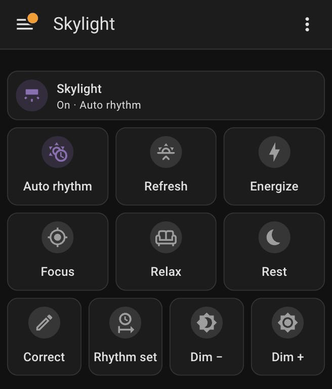
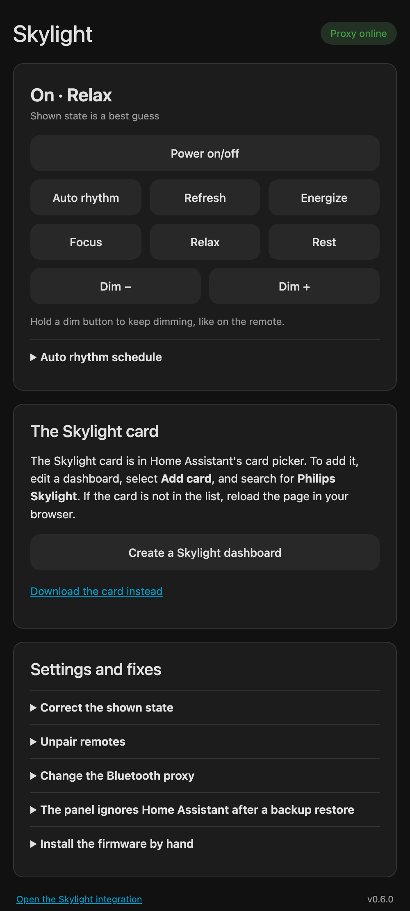
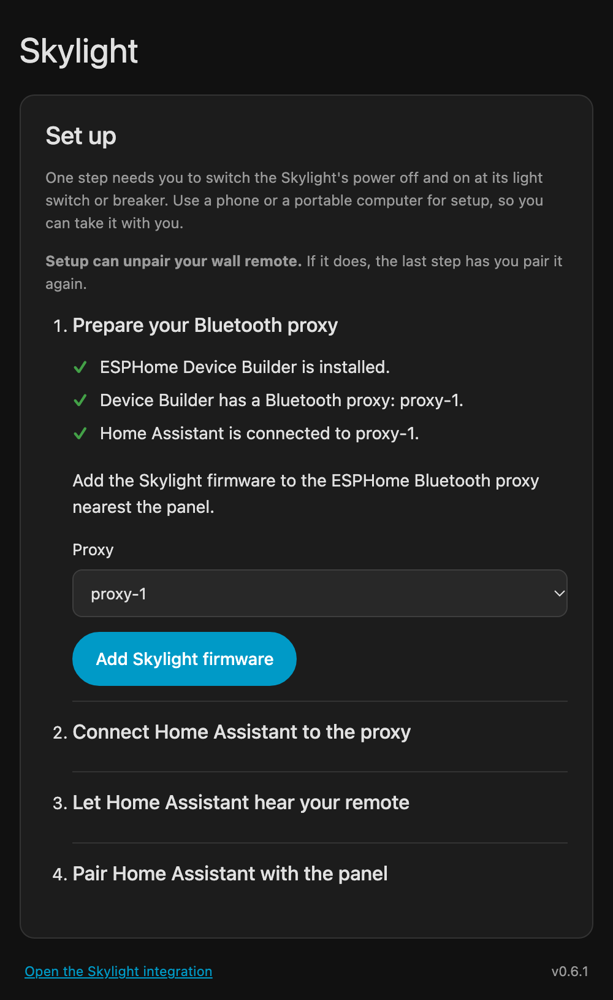
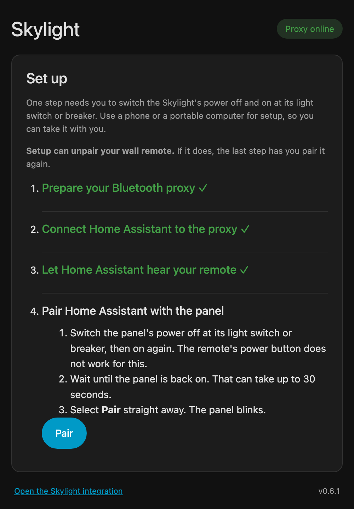
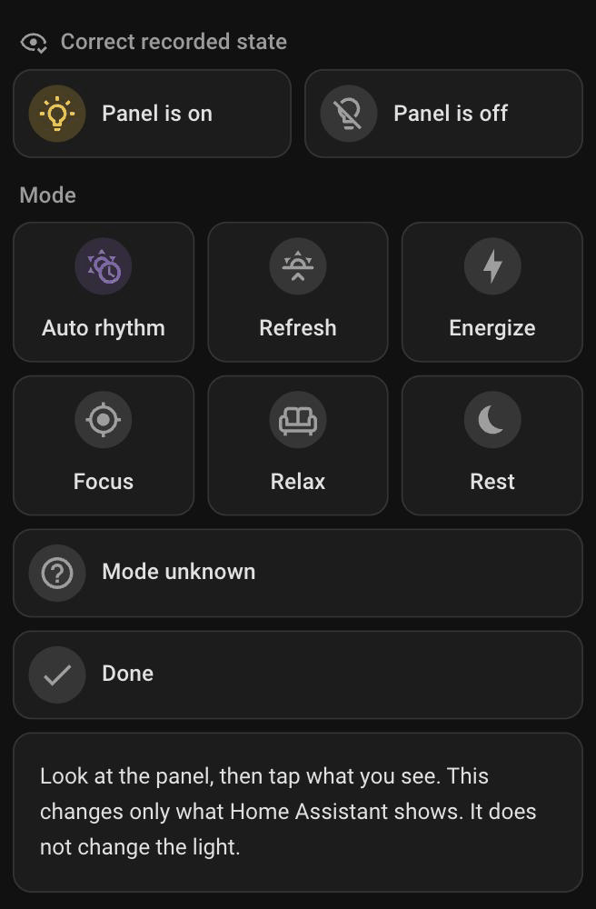

# Philips Skylight for Home Assistant


> **Work in progress.** Early stage alpha. Back up your Home Assistant and only install on a [Bluetooth proxy](https://esphome.io/components/bluetooth_proxy/) you are willing to reset if necessary. Currently, I am the only person who has tried this. 
>
> **One Skylight only.** I have tested this with one Skylight panel. Support for
> several Skylights is not built and not tested. 
> 
>**Own a Skylight?**  Give it a whirl and let me know how it goes. Installation reports, bug reports, feature requests, and pull requests welcome.
> 

The Philips LED Skylight panel comes with a remote and (famously) no smart functionality. It has no app, no Wi-Fi and no Hue support. This project lets Home Assistant act as a
second remote. You get a power toggle, the six modes and dim buttons on your
dashboard and in automations. Your original remote keeps working.
This allows Home Assistant to treat the device as a light entity, enabling you to include your Skylight in your automations, scenes, and more. The add-on also does its best to mirror the current state of your light, including whether it's powered on and its current scene (see limitations below). 
Home Assistant talks to the panel through an [ESPHome Bluetooth proxy](https://esphome.io/components/bluetooth_proxy/). 


I have tried to make the setup of this as easy as possible, although it required a rather elaborate solution for a relatively simple problem. A setup wizard guides you through the process of installing a custom firmware on your [Bluetooth proxy](https://esphome.io/components/bluetooth_proxy/) and will guide you through all the requisite steps necessary to get the add-on set up.

> **AI disclosure:** I built this project with AI coding agents. Claude Opus 5.5 decoded the remote's Bluetooth protocol, using the [Bluetooth proxy](https://esphome.io/components/bluetooth_proxy/) to capture its messages during pairing and button presses. Codex did further development, and Opus did the refactoring and final implementation. I'm a software developer. I wrote the specifications and reviewed the code, but not with the scrutiny I'd give a high-stakes production project. Use it at your own risk.

## What it does

<p>
  
  
</p>

- **A light entity.** The Skylight appears in Home Assistant as a light, with
  the six modes as its effects.
- **Power.** Switch the panel on and off from a dashboard, a voice assistant or
  an automation.
- **All six modes.** Auto rhythm, Refresh, Energize, Focus, Relax and Rest each
  get a button. A mode button also switches the panel on.
- **Dimming.** Dim down and Dim up, one step per tap, or longer with a hold. Setting absolute brightness percentage levels is not supported due to limitations of the device, but I'm considering a hacky way to support this in the future. 
- **The Auto rhythm schedule.** Set the current time as the start of the daily
  schedule, like holding Auto rhythm and Relax on the remote.
- **Your remote keeps working.** Home Assistant hears its presses and updates
  the shown power and mode.
- **State correction.** If the shown state is wrong, tell Home Assistant what
  you see. This changes only the record and sends nothing to the panel.
- **Automations, scripts and scenes.** Use the light, the mode buttons and the
  `philips_skylight.dim` action like any other device.
- **Pairing and unpairing.** Pair Home Assistant with the panel, unpair every
  remote, or start over, from the add-on page or the integration's settings.
- **A ready-made dashboard card.** It uses the remote's icons and colors, and
  the top tile glows in the current mode's color. It is built from Home
  Assistant's own cards, so it needs no custom card or HACS (the Home Assistant
  Community Store). The add-on creates a Skylight dashboard or adds the card to
  one of yours.
- **Guided setup.** A setup checklist adds the Skylight firmware to your [ESPHome
  Bluetooth proxy](https://esphome.io/components/bluetooth_proxy/), with backups, connects it, pairs the panel and tests it.
- **Guided updates.** After an update, the add-on page lists any step left: a
  Home Assistant restart, new proxy firmware, or a newer card.
- **Local only.** No cloud, no account, no app and no MQTT broker. Everything
  stays on your home network.

## Read this first: what it cannot do

This is an experimental project. Please read these limits before you install it.

- **The panel never reports what it is doing.** Home Assistant guesses the power
  and mode from the commands it sends and the remote presses it hears. The guess
  is often right, but it is still a guess.
- **The guess goes wrong sometimes.** A missed remote press, a wall switch, a
  power cut, or a restart of Home Assistant or the proxy all put it out of step.
  When that happens, you look at the panel and tell Home Assistant what you see. **You can always use the power toggle and modes without relying on accurate state information.**
- **Power is a toggle.** The panel has one power command. It switches the panel
  off if it is on, and on if it is off. Everything this project gives you uses
  it: the remote's power button, the card's **Skylight** tile and the add-on
  page. Those always work.

  Home Assistant also adds separate "turn on" and "turn off" commands to every
  light. You get them without asking, in these places:
  - the on/off switch in the light's own dialog and in entity lists,
  - voice assistants, such as "turn off the Skylight",
  - room and "all lights" commands, such as a bedtime automation that turns off
    every light,
  - scenes, and Apple Home through HomeKit.

  The panel has no separate on and off, so Home Assistant decides from the shown
  state. If the shown state is wrong, these commands do the wrong thing. For
  example, if Home Assistant shows the panel as on while it is off, "turn off
  all lights" switches the Skylight **on**. A mode button always leaves the
  panel on, in that mode.
- **It supports one Skylight.** It was built and tested with one panel.
  Support for several panels is not built yet. A panel obeys only the senders
  it has paired with. So any panel that paired with Home Assistant responds to
  its commands, and a second panel paired the same way responds too. Home
  Assistant also tracks every compatible remote it hears, so a second panel's
  remote changes the recorded state.
- **The panel accepts at most two remotes, and Home Assistant counts as one.**
  If two remotes already control your Skylight, this does not work unless you
  give one of them up. If you set this up before on another Home Assistant, use
  **Unpair all remotes** first, then pair your remote again.
- **Setup needs the panel's power switched off and on once**, at its light switch
  or breaker. Use a phone or a portable computer for setup, so you can take it
  with you.
- **You cannot set a brightness level.** The panel takes only "dim down" and
  "dim up" commands. It has no command for a level such as 40%, and it never
  reports its level. So Home Assistant shows no brightness slider, and
  Home Assistant ignores a brightness in `light.turn_on`. Color temperature
  has no command either.
- **It is tested on one setup.** One owner tested it with the NatureConnect/BioUp
  17.7 × 25.6 inch panel and an ESP32-C3 proxy. Other models are unknown.
- **The add-on needs Home Assistant OS or Supervised.** For Container or Core
  installs, use the [integration-only guide](docs/INTEGRATION.md).

## Light switches


I do not advise using the Skylight with a light switch. If you use the Skylight with an ordinary light switch, this automation will not be able to preserve the state, such as the on/off state or the currently selected scene. If you do have such a switch leave the panel's wall switch on. Control the panel with its wall
remote or Home Assistant. A wall switch cuts the power without telling Home
Assistant, so the recorded state goes wrong. You need the wall switch or the
breaker only for pairing.

If the panel's power runs through a **smart** light switch in Home Assistant, an
automation can keep the record in step. Home Assistant records the power with
the **Philips Skylight: Set assumed power** action. It sets the shown power and
sends nothing to the panel. This example follows a switch named
`switch.skylight_wall`:

```yaml
triggers:
  - trigger: state
    entity_id: switch.skylight_wall
    to: ["on", "off"]
actions:
  - action: philips_skylight.set_assumed_power
    target:
      entity_id: light.philips_skylight
    data:
      is_on: "{{ trigger.to_state.state == 'on' }}"
```

When power returns, the panel switches on by itself, so the switch's state is
the panel's power. The mode stays as Home Assistant last recorded it.

## What you need

- Home Assistant OS or Supervised, version 2026.6 or newer.
- A Philips Skylight panel.
- An [ESPHome Bluetooth proxy](https://esphome.io/components/bluetooth_proxy/) near the panel: an ESP32 board with ESPHome
  2026.4.5 or newer. It was tested with an ESP32-C3. An encryption key for its
  [API](https://esphome.io/components/api/) is optional. Without one, any device on your home network can make
  the proxy control the panel. No proxy yet? ESPHome's
  [ready-made projects](https://esphome.io/projects/) page sets one up from your
  browser. Then select **Adopt** on it in ESPHome Device Builder, so that its
  configuration is there.
- [ESPHome Device Builder](https://esphome.io/guides/getting_started_hassio/)
  (or install the firmware yourself). Device Builder is ESPHome's app for Home
  Assistant, and the recommended way. The add-on adds the Skylight firmware to
  the proxy's configuration there, and you install it from Device Builder. To
  install the firmware yourself, build the [`esphome`](esphome/) folder's
  package with your own ESPHome.

## Install

Install the add-on from Home Assistant's own app store, not from HACS (the Home
Assistant Community Store). HACS cannot install add-ons. The add-on installs the
integration for you.

[](https://my.home-assistant.io/redirect/supervisor_add_addon_repository/?repository_url=https%3A%2F%2Fgithub.com%2Fjphelan82%2Fha-philips-skylight)

1. Select the button above. It opens your Home Assistant and offers to add this
   repository. Or add it by hand: open **Settings → Apps**, select **Install
   app** at the bottom right, then **⋮** at the top right **→ Repositories**.
   Add `https://github.com/jphelan82/ha-philips-skylight`. On older versions,
   **Apps** is called **Add-ons**, and **Install app** is called **Add-on
   store**.
2. Install **Philips Skylight**. Turn on **Start on boot**, start it, and open
   its web page.
3. If the page asks you to restart Home Assistant, select **Restart Home
   Assistant**.
4. Follow the setup checklist on the page. Each step gets a ✓ when it is done.
   1. **Prepare your [Bluetooth proxy](https://esphome.io/components/bluetooth_proxy/).** The step first checks what it needs:
      ESPHome Device Builder, a Bluetooth proxy in it, and Home Assistant's
      connection to that proxy. Each missing item says how to fix it. Then
      choose your proxy and select **Add
      Skylight firmware**. The add-on copies the firmware files into your
      ESPHome folder and adds one line to the proxy's YAML. It keeps a backup.
      Then install it in [ESPHome Device Builder](https://esphome.io/guides/getting_started_hassio/): open the proxy, then **⋮ →
      Install → Wirelessly**. The page continues by itself when the proxy is
      back. See [When is the install done?](#when-is-the-install-done) A proxy
      that already has the firmware skips this step.
   2. **Connect Home Assistant to the proxy.** With one compatible proxy, the
      add-on does this by itself. With several, choose one.
   3. **Let Home Assistant hear your remote.** Select **Allow**. This turns on
      the proxy's setting **Allow the device to perform Home Assistant actions**.
   4. **Pair Home Assistant with the panel.** See [Pairing](#pairing). The page
      shows "Pairing…" for 10 seconds. Then select **Switch the panel on or
      off**, and say what the panel did.
      Finally, choose a mode. The panel switches on in that mode, so Home
      Assistant knows its state.
5. Optional: create a Skylight dashboard, or add the Skylight card to one of
   your dashboards. You can also use the entities in your own cards.

<p>
  
  
</p>

No app store? Home Assistant Container and Core have none. Use the
[integration-only guide](docs/INTEGRATION.md). It installs the integration
through HACS or by hand.

Already using the Philips Skylight integration? The add-on keeps your light,
settings and pairing. You do not need to pair again.

### When is the install done?

Device Builder builds the firmware first. The first build takes several
minutes, and longer on a small device such as a Raspberry Pi. Its window never
says that it has finished. Check the add-on page instead: it says "The install
is complete" when the proxy is back with the new firmware. In the Device Builder
log, the install is done when the build messages stop and the proxy's own
messages scroll by. Each of those starts with the time and a letter, such as
`[12:00:01][D]`. You can close the window then.

## Bluetooth Proxy

If you don't already have a Bluetooth proxy, creating one is relatively simple. I used an [inexpensive board + antenna from AliExpress](https://www.aliexpress.us/item/3256806898073871.html), which arrived shipped for $9. I 3D printed [this enclosure](https://makerworld.com/en/models/2145189-seeed-studio-antenna-case-esp32-c3-esp32-c6-s3#profileId-2324071), and I plug it directly into the wall with a USB adapter. These can also run other concurrent tasks. For example, I use my proxy to control my subwoofer volume levels. 

## Update

1. **Update the add-on.** Home Assistant offers the update under **Settings →
   Apps**. Select **Update**. The add-on restarts by itself.
2. **Restart Home Assistant, if the page asks.** The add-on installs its copy of
   the integration when it starts. If that copy is new, the page shows
   **Restart Home Assistant**. The add-on never restarts Home Assistant by
   itself.
3. **Update the proxy firmware, if the page asks.** The page compares three
   things: the add-on's firmware files, the copies in your ESPHome folder, and
   the firmware number that the proxy reports.
   - If the copies are older, the page shows **Update the firmware files**. It
     keeps a backup of the old files.
   - Then, or if the proxy reports an older number, the page asks you to
     install: in [ESPHome Device Builder](https://esphome.io/guides/getting_started_hassio/), open the proxy, then **⋮ → Install →
     Wirelessly**. The proxy is offline for a minute or two, and Home Assistant
     misses remote presses in that time. See
     [When is the install done?](#when-is-the-install-done)
   - If the firmware did not change, the page shows nothing.
4. **Update the card, if the page asks.** A card on a dashboard never changes
   by itself. If a dashboard holds an older Skylight card, the page shows
   **Update the card**. It replaces only the Skylight card and leaves the rest
   of the dashboard as it is.

The page shows a step only when its part changed. An update never needs a new
pairing, and it keeps your settings and the command counter.

After a restart that takes longer than 60 seconds, the recorded power and mode
are unknown. A remote press, a mode button, or **Correct** sets them again.

## Pairing

The panel ignores Home Assistant until you pair it. Pairing is a one-time step.
Updates do not need it. Your remote stays paired.

1. Switch the panel's power off at its light switch or breaker, then on again.
   The remote's power button does not work for this.
2. Wait until the panel is back on. That can take up to 30 seconds.
3. Select **Pair** straight away. Home Assistant sends the pairing request for
   10 seconds, and the panel blinks.

The panel listens for pairing only for a short time after it comes back on, so
do not wait long before you select **Pair**. Home Assistant sends a short burst,
like the remote's own 10-second hold. A long stream of requests makes the panel
drop your remote.

You can also pair from **Settings → Devices & services → Philips Skylight →
Configure → Pair this transmitter**, or with the `philips_skylight.pair_transmitter`
action.

Pair Home Assistant only once. Pairing it again can make the panel drop your
remote, so the add-on page refuses it after setup. To pair again, use **Settings
and fixes → Start over** on the add-on page. It unpairs every remote, has you
pair your remote first, and then pairs Home Assistant through the setup
checklist.

To make the panel forget **every** remote, use **Configure → Unpair all
remotes**, with the same steps. It removes your remote and Home Assistant.
Afterward, pair your remote again with its own steps, and pair Home Assistant
again. No command removes only one remote. If the request reaches the panel too
late, the panel only switches off. Then try again.

Removing or reinstalling the add-on does not unpair the panel, because the panel
stores the pairing itself. That leftover pairing does no harm: nothing else
sends as Home Assistant's address.

## Everyday use

The Skylight card uses the remote's icons and colors.

| Control | What it does |
|---|---|
| **Skylight** | Toggles the panel, like the remote's power button. It shows the recorded power and mode, and glows in the mode's color while the panel is on. |
| Mode buttons | Auto rhythm, Refresh, Energize, Focus, Relax and Rest. A mode button also switches the panel on. The recorded mode lights up in the remote's color. |
| **Correct** | Opens a view to fix Home Assistant's guess. |
| **Rhythm set** | Makes the current time the start of the Auto rhythm schedule. The panel blinks. Auto rhythm does nothing until a start is set. |
| **Dim −** / **Dim +** | A tap is one step. On a dashboard, a hold dims for about 3 seconds after you let go. Keep your finger still, or Home Assistant cancels the hold. On the add-on page, holding keeps dimming until you let go, like the remote. |

## Tell Home Assistant what you see

Do this any time the card does not match the panel.



1. On the card, select **Correct**. On the add-on page, open **Settings
   and fixes → Correct the shown state**.
2. Select **Panel is on** or **Panel is off**.
3. Select the mode you can see, or **Mode unknown**.
4. On the card, select **Done**.

This changes only Home Assistant's record. It does not send anything to the
light. A mode press on your remote also updates the record by itself.

## Automations: use commands, not the guess

The safest automations send a command and do not depend on the recorded state:

- `light.toggle` toggles the power.
- `button.press` on a mode button selects that mode, and switches the panel on.
- `philips_skylight.dim` with `direction: down` or `up` dims by one step. Add
  `hold: 3` to dim like a 3-second hold on the remote.

`light.turn_on` and `light.turn_off` decide whether to toggle from the recorded
power. If the record is wrong, they do the wrong thing. `light.turn_on` with an
effect is the exception: it always sends that mode. Do not use the recorded
state as a trigger or a condition. Do not treat it as proof that the panel
changed.

## Troubleshooting

| Problem | What to try |
|---|---|
| The add-on is not in the store | Check that you can open the repository, and that an add-on release exists. Otherwise, use the local installation. |
| No proxy appears | The setup checklist lists the [Bluetooth proxies](https://esphome.io/components/bluetooth_proxy/) in your ESPHome folder. If none is listed, set up a [Bluetooth proxy](https://esphome.io/components/bluetooth_proxy/) in [ESPHome Device Builder](https://esphome.io/guides/getting_started_hassio/) first. |
| Remote presses do not update the dashboard | Check step 3 of the setup checklist. Move the proxy closer to the panel. Then correct the state. |
| The dashboard shows Unknown, or the wrong power or mode | Use **Correct** and record what you see. |
| The card download says that a control is missing | Turn the Skylight entities back on in **Settings → Devices & services**. |
| The panel ignores every command | Check that the proxy is online. If the panel still ignores Home Assistant, use **Settings and fixes → Start over** on the add-on page. Do not pair Home Assistant a second time: the panel can drop your remote. |
| Commands stopped after a Home Assistant rebuild or an older backup restore | On the add-on page, use **Settings and fixes → The panel ignores Home Assistant after a backup restore**. It fixes the command counter without pairing again. |
| An update asks for a restart | Restart Home Assistant from the add-on page. |
| An install or update fails with "not enough free space" | Home Assistant needs about 2 GB free to install any app. Delete old local backups. |

## Ideas for later

- **Maybe: a brightness level.** To reach a level, Home Assistant dims the
  panel all the way down, then dims it up in timed steps. This needs a
  measured step size and a known lowest level. It is slow, and the panel shows
  every step. Only a maybe.
- During setup, offer to link a smart wall switch to the recorded state with an
  automation.
- Start the pairing burst by itself when the panel comes back on. The panel
  sends a Bluetooth beacon all the time, so the proxy can tell when its power
  goes off and comes back. Then nobody needs to select **Pair** at the right
  moment.
- **Several Skylights.** Not built yet. Two parts are needed:
  - **Control.** Give each panel its own Home Assistant sender address (`0x7FFE`,
    `0x7FFD`, and so on), and pair each address only with its own panel. This
    needs the panels on separate circuits, because one power cycle opens the
    pairing window of every panel on that circuit. Each panel accepts at most
    two senders, so each panel can have one remote besides Home Assistant.
  - **State tracking per panel.** Home Assistant hears and decrypts every remote
    press, paired or not. The preferred design is a table that maps each
    remote's mesh address to its panel. The user fills it in during setup by
    pressing each remote once. The remotes stay paired to their panels, so they
    keep working without Home Assistant. A panel's relay of a press does not
    help: on 2026-10-13 the panel relayed presses from a remote it had dropped.
  - **This needs each remote to have its own mesh address.** The tested remote
    sends as `0x7FFF`. Whether every remote of this model uses `0x7FFF` is
    unknown. If two remotes share an address, Home Assistant cannot tell their
    presses apart. A capture of a second remote's press answers this. A remote
    paired to two panels controls both, so its presses update both records.
  - **Fallback if remotes share an address:** unpair the remotes from the
    panels, and let Home Assistant forward each press to the right panel from
    that panel's sender address. Then the state is exact. The cost is that the
    remotes stop working whenever Home Assistant, the proxy or Wi-Fi is down,
    and each press has a little more delay.

## More detail

- [Add-on documentation](philips_skylight/DOCS.md): options, permissions,
  recovery and removal.
- [Dashboard guide](docs/DASHBOARD.md): the card, and manual card setup.
- [Integration-only guide](docs/INTEGRATION.md): for installs without add-ons.
- [Protocol notes](docs/PROTOCOL.md): how the panel's Bluetooth Mesh commands
  work, and developer instructions.
- [Validation record](docs/VALIDATION.md): what was tested on real hardware.
- [Releasing](docs/RELEASING.md): how to publish a new version.
